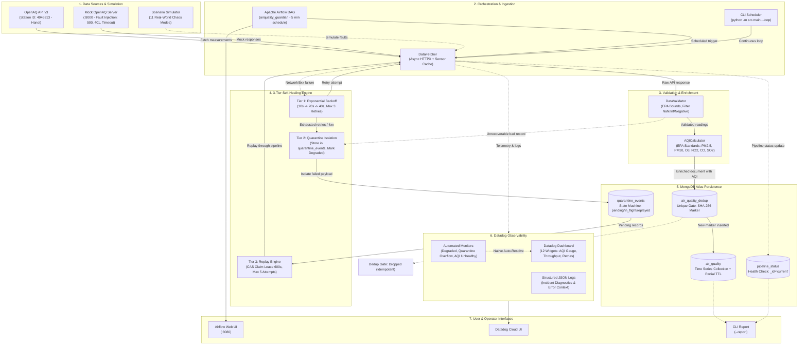

# AirQuality Guardian

> **Self-Healing Data Pipeline cho Real-Time Air Quality Monitoring**  
> Dự án tham gia Hackathon — Tích hợp **MongoDB Atlas (Time Series)** & **Datadog Observability**.

[](https://github.com/nguyendinhtanloc-Org/hackathone-airquality-guardian/actions)


---

## 1. Giới thiệu

Hệ thống giám sát chất lượng không khí tại Hà Nội (Trạm quan trắc Giải Phóng - ID `4946813`) sử dụng dữ liệu từ OpenAQ v3 với khả năng **tự phát hiện, cách ly và tự phục hồi (Self-Healing)** khi xảy ra sự cố API sập, timeout mạng, hoặc cảm biến gửi dữ liệu dị thường.

### Điểm nổi bật
- **Self-Healing Pipeline**: Tự động Retry với hàm mũ (10s -> 20s -> 40s), cách ly (Quarantine) vào MongoDB khi cạn retry, và Replay phục hồi an toàn.
- **Deduplication Tuyệt đối**: Cơ chế **Marker-First Dedup (SHA-256)** bảo đảm tính Idempotent — không bao giờ trùng lặp bản ghi kể cả khi replay hay crash giữa chừng.
- **MongoDB Time Series**: Lưu trữ tối ưu với Time Series Collection (`timestamp`, `metadata.location_id`), tích hợp TTL tự dọn dẹp.
- **Datadog Full Observability**: Dashboard 12 widgets theo dõi throughput, độ trễ, logs sự cố có cấu trúc, và 3 Monitors cảnh báo tự động.
- **236/236 Tests Passed**: Bao phủ toàn bộ Unit test, Integration test, E2E và self-healing scenario.

---

## 2. Kiến trúc Hệ thống & Luồng Dữ liệu (System Architecture)



---

## 3. Tech Stack

- **Ngôn ngữ & Runtime**: Python 3.10+ / 3.11
- **Cơ sở dữ liệu**: MongoDB Atlas (Time Series Collections)
- **Hệ thống giám sát (Observability)**: Datadog (Dashboard, Monitors, Structured Logs, Metrics)
- **Lập lịch tác vụ (Orchestration)**: Apache Airflow 2.10
- **Nguồn dữ liệu**: OpenAQ API v3
- **Đóng gói & Triển khai**: Docker, Docker Compose, Cloud (Render / Railway / Fly.io)

---

## 4. Cài đặt & Chạy Local

### 4.1. Clone và cài đặt môi trường
```bash
git clone https://github.com/nguyendinhtanloc-Org/hackathone-airquality-guardian.git
cd hackathone-airquality-guardian

# Tạo venv
python -m venv venv
# Kích hoạt venv:
# Trên Windows:
.\venv\Scripts\activate
# Trên Linux/Mac:
source venv/bin/activate

# Cài đặt thư viện
pip install -r requirements.txt
```

### 4.2. Cấu hình biến môi trường
Tạo file `.env` từ `.env.example`:
```bash
cp .env.example .env
```
Điền các giá trị:
- `MONGODB_URI`: Chuỗi kết nối MongoDB Atlas
- `OPENAQ_API_KEY`: API Key từ OpenAQ
- `DATADOG_API_KEY`, `DATADOG_APP_KEY`, `DATADOG_SITE`: Thông tin tài khoản Datadog

### 4.3. Các lệnh thực thi chính

```bash
# 1. Chạy 1 chu kỳ bình thường (Fetch -> Validate -> Lưu MongoDB -> Gửi Datadog)
python -m src.main

# 2. Chạy liên tục theo chu kỳ (mỗi 5 phút) - Lệnh dùng để Deploy Cloud
python -m src.main --loop

# 3. Phục hồi và nạp lại dữ liệu từ vùng cách ly (Replay Quarantine)
python -m src.main --replay --replay-limit 100

# 4. Xuất báo cáo nhanh chất lượng không khí hiện tại và lịch sử (Read-only CLI)
python -m src.main --report

# 5. Khởi tạo Dashboard & Monitors lên tài khoản Datadog
python scripts/apply_dashboard.py
python scripts/apply_datadog.py

# 6. Chạy Simulator giả lập 11 kịch bản sự cố để Demo
python scripts/simulate.py
```

### 4.4. Chạy kiểm thử (Test Suite)
```bash
python -m pytest -q
# Kết quả: 236 passed
```

---

## 5. Triển khai Cloud (Deployment)

Chi tiết quy trình triển khai chạy 24/7 lên nền tảng Cloud (Render / Railway / Fly.io) có trong [docs/DEPLOY.md](docs/DEPLOY.md):
- **Start Command**: `python -m src.main --loop`
- **Tự động khởi tạo index**: Pipeline tự động kiểm tra và khởi tạo toàn bộ index (Time Series, Dedup Unique, TTL, Quarantine) khi khởi động.

---

## 6. Tài liệu Chi tiết

- [Kiến trúc Tự phục hồi (Self-Healing Architecture)](docs/SELF_HEALING.md)
- [Mô hình Dữ liệu MongoDB (Data Models & Schemas)](docs/DATA_MODEL.md)
- [Cấu hình Giám sát Datadog (Dashboard & Monitors)](docs/DATADOG.md)
- [Hướng dẫn Triển khai Cloud (Deployment Runbook)](docs/DEPLOY.md)
- [Kịch bản Trình diễn Giám khảo (Demo Runbook)](docs/DEMO.md)
- [Bảng Nhiệm vụ & Tiến độ (Timeline & Tasks)](docs/timeline.md)

---

## 7. Phân công Nhóm

- **Người 1 (Data Pipeline & Runtime)**: OpenAQ Fetcher, Data Validator (EPA ranges), Pipeline Engine, Scheduler (`--loop`), CLI Replay, Dedup SHA-256 Gate, CI/CD E2E tests.
- **Người 2 (Data Platform & Observability & Ops)**: MongoDB Time Series Collections, Datadog Dashboard & Monitors templates, Quarantine Concurrency Management, CLI Report, Deployment & Docs.

---

## 8. License
MIT License
