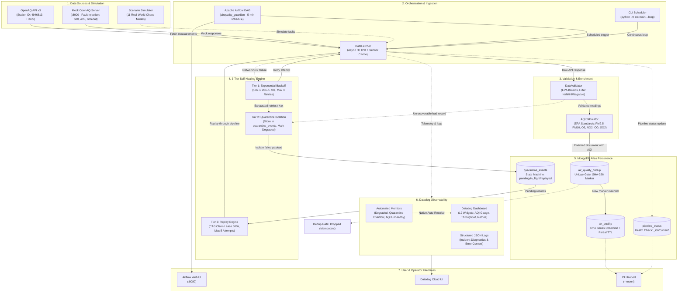

# AirQuality Guardian - System Architecture & Data Flow

> **Self-Healing Data Pipeline for Real-Time Air Quality Monitoring**  
> Integrated with **MongoDB Atlas (Time Series Collections)** & **Datadog Observability**.

---

## 1. High-Level Architecture Diagram (Mermaid)

---

## 2. Core Components Description

### 1. Data Ingestion & Enrichment
- **`DataFetcher`**: Gửi request bất đồng bộ tới OpenAQ API v3. Tích hợp bộ đệm (Sensor Cache) lưu trữ thông tin cảm biến, giảm $80\%$ số lượng request thừa.
- **`DataValidator`**: Áp dụng giới hạn vật lý theo chuẩn EPA, loại bỏ dữ liệu âm, NaN, Infinite. Nếu một cảm biến gửi giá trị dị thường, các thông số sạch khác vẫn được giữ lại xử lý.
- **`AQICalculator`**: Chuẩn hóa đơn vị đo (ppm/ppb sang $\mu\text{g/m}^3$) và tính toán chỉ số AQI cho 6 chất ô nhiễm chính: PM2.5, PM10, O3, NO2, CO, SO2.

### 2. 3-Tier Self-Healing Architecture
1. **Tier 1 (Exponential Backoff Retry)**: Khi gặp lỗi mạng, timeout hoặc HTTP 5xx từ API, hệ thống tự động retry với khoảng chờ $10\text{s} \to 20\text{s} \to 40\text{s}$ (tối đa 3 lần).
2. **Tier 2 (Quarantine Storage)**: Khi cạn lượt retry hoặc gặp lỗi 4xx client error, pipeline không dừng (no crash) mà chuyển sang trạng thái `degraded`, lưu toàn bộ payload và stack trace vào `quarantine_events`.
3. **Tier 3 (Idempotent Replay)**: Cơ chế Replay với CAS concurrency lock (lease 600s) và giới hạn trần 5 lần replay, tự động tái xử lý bản ghi khi upstream hoạt động trở lại.

### 3. MongoDB Atlas Schema & Collections
- **`air_quality` (Time Series)**: Cấu hình `timeField: "timestamp"`, `metaField: "metadata.location_id"`, hỗ trợ TTL index kèm `partialFilterExpression`.
- **`air_quality_dedup` (Idempotent Gate)**: Unique Index `{ "dedup_key": 1 }` lưu mã băm SHA-256 từ `(metadata + timestamp + measurements + aqi)`, ngăn chặn nhân đôi bản ghi khi replay.
- **`quarantine_events`**: Quản lý trạng thái cách ly (`pending` -> `in_flight` -> `replayed` / `failed`) với TTL tự xóa sau 7 ngày.
- **`pipeline_status`**: Ghi nhận trạng thái vận hành tức thời (`running`, `degraded`, `stopped`) tại `_id: "current"`.

### 4. Datadog Observability & Alerting
- **Metrics**: Đo lường Throughput (`pipeline.records.fetched`, `inserted`, `skipped_dedup`, `failed`), Latency, Retry counter, và Queue length.
- **Logs**: Ghi nhận có cấu trúc kèm thông tin incident và ddtags.
- **Monitors**: 3 monitors tự động kích hoạt và auto-resolve khi hệ thống tự phục hồi (`pipeline degraded`, `quarantine overflow`, `AQI unhealthy`).