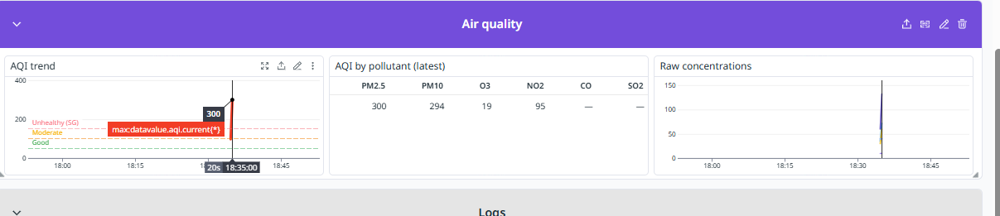

BƯỚC 1: CÁCH CHỈNH THANH ĐIỀU HƯỚNG TRÊN CÙNG

Trước khi nhìn vào các ô, nhìn lên góc trên bên phải màn hình Datadog:

Khung thời gian (Timepicker): Bấm vào và chọn Past 15 minutes (hoặc Past 1 hour). Vì ta  vừa chạy script mô phỏng cách đây vài phút, để khung 15 phút sẽ thấy các nét vẽ biểu đồ to và rõ nhất.
Thanh biến lọc (Template Variables): Ở hàng trên cùng có 3 ô: $env, $location_id, $scenario.
BƯỚC 2: GIẢI MÃ TỪNG NHÓM WIDGET
┌────────────────────────────────────────────────────────┐
│  NHÓM 1: TỔNG QUAN HỆ THỐNG (Dãy ô số to trên cùng)   │
└────────────────────────────────────────────────────────┘

Đây là nơi nhìn vào trong 3 giây là biết hệ thống đang sống hay chết:

Current AQI (Chỉ số chất lượng không khí hiện tại):
Mô tả: Đồng hồ đo chỉ số AQI tổng hợp lớn nhất của trạm Hà Nội.
Hiện tại đang như thế nào: Sau kịch bản số 9 (ô nhiễm đột biến), nó từng vọt lên mức ~300 (màu đỏ thẫm - Hazardous), và sau chu kỳ 1 nó hồi về mức xanh hoặc vàng (~50-80).
Ý nghĩa demo: Cho thấy hệ thống tính toán được AQI chuẩn EPA thời gian thực.
Pipeline status (1 = degraded):
Mô tả: Trạng thái sức khỏe pipeline. Nếu bình thường là 0 (màu xanh lá); nếu có sự cố sập API hoặc lỗi ghi DB sẽ nhảy lên 1 (màu đỏ - Degraded).
Hiện tại: Vừa có một khoảng chuyển đỏ khi chạy kịch bản 10 (sập 503), sau đó trở lại màu xanh khi hệ thống tự phục hồi.
Records inserted (window):
Mô tả: Tổng số bản ghi sạch đã được lưu thành công vào cơ sở dữ liệu MongoDB trong khoảng thời gian đang xem.
Hiện tại: Con số này đang tăng lên (mỗi chu kỳ hợp lệ nạp từ 2 đến 6 bản ghi).
Success rate % (Tỷ lệ xử lý thành công):
Mô tả: Công thức = 100 * (số bản ghi hợp lệ / số bản ghi lấy về).
Hiện tại: Khi gặp kịch bản 5 (cảm biến gửi số âm/NaN), tỷ lệ này tụt xuống ~33% (vàng/đỏ), rồi sau đó hồi lại 100% (xanh).
Pending quarantine:
Mô tả: Số lượng bản ghi đang bị "nhốt" trong vùng cách ly MongoDB chờ sửa chữa.
Hiện tại: Vừa nhảy lên 1 khi sập mạng, và tụt về 0 ngay sau khi replay thành công!
Monitors (Trạng thái cảnh báo):
Mô tả: Trạng thái của 3 cảnh báo tự động. Nếu xanh hết là OK; nếu có chấm đỏ là monitor đang phát chuông cảnh báo.
┌────────────────────────────────────────────────────────┐
│  NHÓM 2: LƯU LƯỢNG PIPELINE (Pipeline Throughput)      │
└────────────────────────────────────────────────────────┘
Records per cycle (Biểu đồ đường nạp dữ liệu):
Vẽ nhiều đường màu: fetched (lấy về), valid (hợp lệ), inserted (ghi mới), skipped_dedup (bỏ qua do trùng lặp), failed (bản ghi hỏng).
Điểm nhìn: Một vệt đỏ nhô lên tương ứng với kịch bản số 5 (4 bản ghi sensor bẩn bị từ chối).
Cycle latency (Độ trễ mỗi chu kỳ):
Đo thời gian từ lúc gửi request OpenAQ đến khi ghi xong vào DB (thường dưới 0.5s - 1s).
Cycles by scenario (Bảng xếp hạng kịch bản):
Bảng liệt kê số chu kỳ đã chạy phân theo kịch bản: normal, transient_timeout, bad_sensor_data, pollution_spike, outage_then_replay.
┌────────────────────────────────────────────────────────┐
│  NHÓM 3: KHẢ NĂNG TỰ PHỤC HỒI (Self-Healing) ★ ĐIỂM CỘNG HACKATHON
└────────────────────────────────────────────────────────┘

Đây là nhóm quan trọng nhất để thuyết trình cho giám khảo:

Retries & attempts:
Mô tả: Bình thường attempts = 1 (gọi 1 lần ăn ngay).
Hiện tại: Nếu chạy script stimulate thì sẽ thấy đỉnh nhọn vọt lên số 3! Đó chính là lúc kịch bản 2 kích hoạt: API timeout 2 lần 
→
→ hệ thống tự retry lần 3 mới thành công.
Incidents: retryable vs permanent:
Phân biệt lỗi tạm thời (mạng rớt 
→
→ tự retry) và lỗi vĩnh viễn (sai key 401 
→
→ không retry mất công mà cách ly ngay).
Quarantine backlog:
Biểu đồ hình bậc thang: nhô lên khi API sập và hạ xuống 0 khi lệnh Replay cứu hộ dữ liệu thành công.
┌────────────────────────────────────────────────────────┐
│  NHÓM 4: CHI TIẾT CHẤT Ô NHIỄM (Air Quality)          │
└────────────────────────────────────────────────────────┘
AQI trend: Đường biểu đồ dao động của chỉ số chất lượng không khí. Khi chạy stimulate.py thì sẽ xuất hiện "ngọn núi" nhô cao vút chính là lúc mô phỏng đợt ô nhiễm nặng.

Raw concentrations: Nồng độ thực tế theo đơn vị vật lý (
𝜇
𝑔
/
𝑚
3
μg/m
3
) của từng chất: đường màu tím là PM2.5, xanh là PM10, v.v.
AQI by pollutant (Bảng tra cứu): Bảng thống kê chỉ số AQI riêng rẽ của 6 chất ô nhiễm tại lần đọc mới nhất.
┌────────────────────────────────────────────────────────┐
│  NHÓM 5: NHẬT KÝ SỰ CỐ THỜI GIAN THỰC (Logs Stream)    │
└────────────────────────────────────────────────────────┘
Incidents Log Stream:
Chỉ lọc các sự cố (status: error): Các dòng log màu đỏ ghi rõ: Lý do lỗi (503 Service Unavailable / Timeout), mã sự cố (UUID), số lần đã thử.
Pipeline runs Log Stream:
Ghi lại nhật ký mỗi khi 1 vòng hoàn thành: số lượng đọc được, số bản ghi hợp lệ, thời gian xử lý.